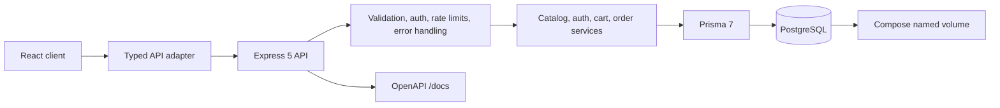
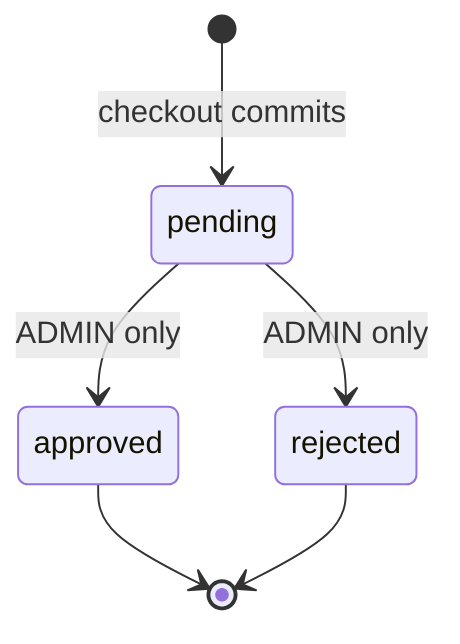

# CLU Store API — V1 architecture

**Status:** reconciled documentation baseline; implementation has not started. This describes intended behavior, not behavior verified in running code.

## Decisions

| Area | V1 decision |
|---|---|
| Runtime and HTTP | Node.js 24 LTS; Express 5; TypeScript strict mode; ESM |
| Persistence | PostgreSQL, developed locally with Docker Compose; Prisma 7 |
| Money | CNY; Prisma Decimal / PostgreSQL `numeric(12,2)`; monetary JSON values are decimal strings |
| Catalog identifiers | Preserve original numeric product, category, model, and memory option IDs when sourced unambiguously |
| Wire format | Standard JSON envelope for API responses; frontend adds an adapter that unwraps `data` |
| Product price | Model `price` is the full base price; memory `price` is the incremental upgrade. Unit price = model base + memory upgrade. `startingPrice` is informational and is never added again. |
| New arrivals | A card may be editorial and have a nullable product link. |
| Order decisions | Only ADMIN may approve/reject; only `pending` transitions to a terminal state. |
| Checkout | Real PostgreSQL transaction; persist order, snapshots and initial history, and clear only the purchaser's cart atomically. |

Node 24 is a major-line target; select and pin a current patch at implementation time. Do not infer unprovided catalog facts or create sample fixture content.

## System shape

The API owns validation, identity, authorization, price calculation, and order state. The client does not supply authoritative prices. Separate liveness (`/health`) from database-dependent readiness (`/ready`). Tests for transactional behavior use a dedicated PostgreSQL test database.

## Order status machine

Each status change and its history row commit atomically. Conditional transition from `pending` prevents two concurrent admin decisions from both succeeding. Other transitions return `409 ORDER_INVALID_TRANSITION`.

## Security risk register

| Risk | Required control / implementation gate |
|---|---|
| Unauthenticated or non-admin order decision | JWT authentication and server-side ADMIN role check on both transition routes; legacy `noauth` label is rejected as a contract source. |
| Cross-user cart/order access | Derive owner from authenticated subject; enforce ownership in database operations; return safe not-found behavior for inaccessible orders. |
| Forged prices/configuration | Resolve model, memory, color and availability from database; calculate Decimal price server-side; ignore legacy client price/name fields. |
| Password or token exposure | Argon2id hashes; strong environment-managed JWT key; redact authorization, cookies, passwords and secrets; never seed a known admin credential. |
| Credential stuffing / abuse | Strict per-IP (and privacy-safe account) login/register limits, bounded JSON bodies, allowlisted CORS, Helmet, validated input. |
| Unsafe legacy support HTML | Only reviewed sanitized HTML / safe protocol and attribute allowlist; client sanitizes as defense in depth. Treat source HTML as untrusted. |
| Secret-bearing Postman material | Original collection is sensitive. Never copy its bearer values or headers; any later rebuilt collection must be sanitized. |
| Idempotency race / partial checkout | Unique per-user idempotency key, request fingerprint and PostgreSQL transaction; integration tests cover replay, conflict, concurrency and rollback. |
| Database exposure | Compose-only service network; avoid public host binding; separate development/test databases; inject secrets at runtime. |
| Historical marketing misrepresented as current | Historical 2025 offers inactive; do not copy legacy remote image URLs into data. |

## Phased definition of done

P00 (this phase): local baseline recorded and reconciled contract docs exist, with absent inputs called out. P01–P02: runnable foundation and reviewed schema/migrations against isolated PostgreSQL. P03–P04: provenance-backed catalog and public routes. P05–P08: authentication, owned cart, atomic checkout and admin order workflow verified against PostgreSQL. P09–P11: OpenAPI/sanitized collection, integration/security gates, Compose and CI. P12: separately verified frontend adapter and end-to-end flows. P13: final contract/security audit and V1 freeze. A phase is done only with actual command outcomes and scoped change review; backend completion alone does not establish frontend integration.

See [api-contract.md](api-contract.md), [data-model.md](data-model.md), [fixture-provenance.md](fixture-provenance.md), and [local-development.md](local-development.md).
