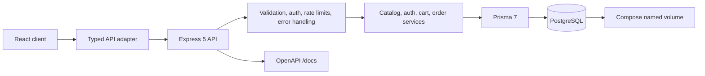
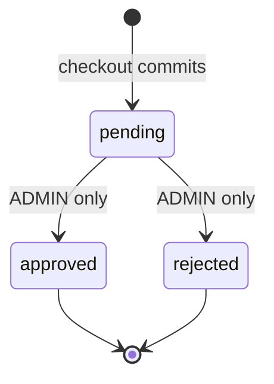

# CLU Store API — V1 architecture

**Status:** P09 generated documentation and the P04–P08 read/auth/cart/checkout/order API are implemented alongside the HTTP/database foundation and demo seed. This document also describes remaining V1 work.

## Decisions

| Area | V1 decision |
|---|---|
| Runtime and HTTP | Node.js 24 LTS; Express 5; TypeScript strict mode; ESM |
| Persistence | PostgreSQL, developed locally with Docker Compose; Prisma 7 |
| Money | CNY; Prisma Decimal / PostgreSQL `numeric(12,2)`; monetary JSON values are decimal strings |
| Catalog identifiers | Preserve original numeric product, category, model, and memory option IDs when sourced unambiguously |
| Wire format | Standard JSON envelope for API responses; frontend adds an adapter that unwraps `data` |
| Product price | Model `price` is the full base price; memory `price` is the incremental upgrade. Unit price = model base + memory upgrade. `startingPrice` is informational and is never added again. |
| New arrivals | A card may be editorial and have a nullable product link. |
| Order decisions | Only ADMIN may approve/reject; only `pending` transitions to a terminal state. |
| Checkout | Read Committed PostgreSQL transaction with owner/catalog row locks; persist order, snapshots, initial history and replay receipt, and consume purchased cart lines atomically. Direct SKU mode preserves cart. |

Node 24 is a major-line target; select and pin a current patch at implementation time. Do not infer unprovided catalog facts or create sample fixture content.

## System shape

The API owns validation, identity, authorization, price calculation, and order state. The client does not supply authoritative prices. Separate liveness (`/health`) from database-dependent readiness (`/ready`). Tests for transactional behavior use a dedicated PostgreSQL test database.

## Order status machine

P07 creates the pending order and initial history atomically. P08 commits each ADMIN decision and its history row atomically: a conditional transition from `pending` prevents two concurrent decisions from both succeeding; other transitions return `409 ORDER_INVALID_TRANSITION`. Placement replay always returns its saved creation receipt; P08 order reads return fresh status.

## Security risk register

| Risk | Required control / implementation gate |
|---|---|
| Unauthenticated or non-admin order decision | P08 requires JWT and ADMIN guards, then rechecks the operator under a transaction share lock; legacy `noauth` is rejected. |
| Cross-user cart/order access | Derive owner from authenticated subject; enforce ownership in database operations; return safe not-found behavior for inaccessible orders. |
| Forged prices/configuration | Resolve model, memory, color and availability from database; calculate Decimal price server-side; ignore legacy client price/name fields. |
| Password or token exposure | Argon2id hashes; strong environment-managed JWT key; redact authorization, cookies, passwords and secrets; never seed a known admin credential. |
| Credential stuffing / abuse | Strict per-IP (and privacy-safe account) login/register limits, bounded JSON bodies, allowlisted CORS, Helmet, validated input. |
| Unsafe legacy support HTML | Only reviewed sanitized HTML / safe protocol and attribute allowlist; client sanitizes as defense in depth. Treat source HTML as untrusted. |
| Secret-bearing Postman material | Original collection is sensitive. Never copy its bearer values or headers; any later rebuilt collection must be sanitized. |
| Idempotency race / partial checkout | P07 shared owner lock, unique per-user key, persisted fingerprint/creation receipt and one PostgreSQL transaction; real tests cover overlapping requests and database rollback faults. |
| Unknown commit outcome / omitted key | Keyed client retries recover the saved receipt; optional unkeyed direct checkout has no duplicate/replay guarantee. Unknown connection/commit errors are not blindly retried. |
| Catalog mutation / stale cart price | Share-lock all selected SKU rows, validate current ownership/stock and use Decimal live model-plus-memory pricing. Snapshot descriptions/amounts persist independently of later edits. |
| Out-of-band writes / metadata edits | Future writers must honor owner lock order and preserve snapshots/replay metadata. Database constraints alone do not enforce immutable history or application quantity caps. |
| Competing ADMIN decisions / partial history | P08 conditional pending-only UPDATE and history insert in one transaction; PostgreSQL concurrency and injected history-failure tests verify one winner and rollback. |
| Unbounded lists / metadata injection | Bounded keyset pagination; allowlisted note metadata, no arbitrary JSON or GET bodies; render notes as text. |
| Database exposure | Compose-only service network; avoid public host binding; separate development/test databases; inject secrets at runtime. |
| Historical marketing misrepresented as current | Historical 2025 offers inactive; do not copy legacy remote image URLs into data. |

## Phased definition of done

P00: local baseline recorded and reconciled contract docs exist, with absent inputs called out. P01–P02: runnable foundation and reviewed schema/migrations against isolated PostgreSQL. P03–P04: provenance-backed catalog and public routes. P05–P08: authentication, owned cart, atomic checkout and admin order workflow verified against PostgreSQL. P09–P11: OpenAPI/sanitized collection, integration/security gates, Compose and CI. P12: separately verified frontend adapter and end-to-end flows. P13: final contract/security audit and V1 freeze. A phase is done only with actual command outcomes and scoped change review; backend completion alone does not establish frontend integration.

See [api-contract.md](api-contract.md), [data-model.md](data-model.md), [fixture-provenance.md](fixture-provenance.md), and [local-development.md](local-development.md).

## P05 authentication boundary

`src/modules/auth` owns request schemas, the account repository, password hashing, JWT signing/verification, services and route controllers. `src/middleware/auth.ts` exports `requireAuth` and `requireRole`. `server.ts` creates the service from the database and validated environment; the app accepts it as a dependency. No production probe route is added solely to demonstrate authorization.

The original case-insensitive functional unique indexes remain authoritative. Registration can only create USER; `scripts/create-admin.ts` is an explicit create-only operator path using a password from stdin and an explicit database-name confirmation. The seed never creates an administrator. The API selects or serializes safe user fields explicitly; password hashes only enter credential verification.

Argon2id and JOSE versions are pinned in the lockfile. JWT uses an environment-managed 256-bit HS256 key with issuer/audience checks and a 15-minute default expiration. Every protected request re-fetches the role. Per-IP/per-identifier limits and bounded hashing protect a single process; shared limiting, TLS, proxy configuration and token lifecycle enhancements remain deployment gates. Exact policies, residual risks and P06 handoff are in [the auth contract](api-contract.md#p05-authentication) and [verification](p05-verification.md).

## P06 cart boundary

`src/modules/cart` contains the single route/controller layer, request schemas, service, repository, explicit DTO serializer and a separate synthetic demo function. One router instance is mounted at both intentional URL spellings. Protected operations reuse P05 auth and scope all data by its current authenticated UUID; the public demo never enters the repository.

Cart writes acquire an owner row lock before reading quantities/caps or creating a cart, and share-lock the selected SKU for adds. Existing database uniqueness constraints and foreign keys remain in place. Reads load related catalog records sequentially in a Repeatable Read transaction to retain a consistent snapshot and avoid concurrent queries on the same pg connection. GET reprices for display; P07 follows the same owner-lock order and revalidates/reprices/snapshots/consumes atomically. Cart operations themselves do not reserve stock or create orders.

The local client remains reducer/localStorage based. P12 owns the authenticated frontend integration. [P06 contract](api-contract.md#p06-carts) records exact caps, DTOs, compatibility and errors; [verification](p06-verification.md) records actual database tests.

## P07 checkout boundary

`src/modules/orders` contains request/key validation, fingerprinting, route/controller, service, transaction repository, creation serializer and bounded retry policy. `src/modules/cart/locking.ts` supplies the shared User `FOR UPDATE` lock. The runtime injects the same Prisma client; all checkout persistence runs through its one interactive transaction, with no external side effects inside retries.

The lock order is owner first, then cart lines in ascending ID, then the selected catalog rows in product/model/memory/color ID order. Replay is read after the owner lock and before cart validation. Each SKU join validates product ownership and takes `FOR SHARE` locks on Product, ProductModel, ProductMemorySize and ProductColor until commit, so names, prices and availability cannot change while being snapshotted. Different users can share catalog read locks. All P06 add/delete/clear operations acquire the same owner lock, including first-cart creation; this serializes cooperating checkout/cart writes for one user without relying on an in-process mutex.

Isolation is explicitly **Read Committed**, chosen so a request waiting for another checkout's owner lock sees its committed order in the next statement. Existing `(userId,idempotencyKey)` uniqueness provides final duplicate protection. All order/item/history/receipt writes and purchased-line deletions use one transaction. A deletion count mismatch also throws and rolls back. Direct-item mode uses the same owner/catalog locking and order persistence but does not touch cart lines.

Only known Prisma P2034 transaction conflicts are retried from the beginning, with three total attempts and 20/40 ms waits. The pinned PostgreSQL adapter maps serialization failure 40001 and deadlock 40P01 to that code. Unknown errors, unique violations, timeouts and uncertain commit outcomes propagate as sanitized failures. The transaction has a 5-second acquisition bound and 10-second execution bound, plus existing database timeouts. Request work is bounded by 50 lines/500 units; no payment, inventory decrement or network operation occurs within the transaction.

This is a cooperating row-lock protocol, **not PostgreSQL Serializable isolation or proof of global serializability**. Arbitrary SQL writers and future admin workflows must follow documented ordering/invariants. [PostgreSQL's Read Committed rules](https://www.postgresql.org/docs/18/transaction-iso.html) and [row-lock behavior](https://www.postgresql.org/docs/18/explicit-locking.html#LOCKING-ROWS) inform the design. Actual concurrent requests, observed database lock waits, catalog update waits and injected PostgreSQL failures are recorded in [P07 verification](p07-verification.md).

P08 adds owner/ADMIN reads and atomic ADMIN transitions while preserving the creation receipt and item snapshots. P09/P12 must document/adapt the explicit receipt DTO and retain client idempotency keys across uncertain responses. Boolean availability is checked but not reserved; payment, stock counts, refunds and shipping remain outside V1.

## P08 order management boundary

The order module now has management request schemas, service and repository alongside P07 checkout. Shared explicit item serialization preserves the placement contract; current-state DTOs additionally expose owner UUID, updatedAt and bounded history metadata. They never load account relations or raw checkout metadata. Routes use the existing current-role authentication and ADMIN guard. USER detail queries include owner identity in SQL; the own list remains scoped even for ADMIN.

Detail and list loads use Repeatable Read transactions and sequential batched child queries. Lists use a strict `(createdAt,id)` cursor and allowlisted newest/oldest ordering, capped at 100 orders. The existing owner/time/ID index handles private lists; the additive `20261021000000_order_list_index` migration supports global ADMIN lists. Pagination does not scan skipped offsets or require counting all orders. Each page is a separate snapshot, not a traversal-wide snapshot or a load-performance guarantee.

Decisions use Read Committed. Lock order is operator User `FOR SHARE`, then the conditional order UPDATE; the operator role is rechecked while locked. Unlike an exclusive operator lock, share locks permit same-ADMIN concurrent actions to exercise the order predicate. PostgreSQL rechecks the pending predicate after a competing update commits. The winner records its terminal history with authenticated operator and the exact PostgreSQL updatedAt timestamp. The loser returns 409; missing IDs return 404. A history insert failure rolls back status/updatedAt. No item, total, currency, key, fingerprint or order receipt metadata is rewritten.

P08 does not automatically retry decisions, call external services, create payment URIs or add reverse transitions. Request-start role freshness remains the policy for reads; mutations additionally hold the operator lock through commit. Direct database writes remain outside the lifecycle guarantee. The relevant PostgreSQL mechanisms are documented in [Read Committed update behavior](https://www.postgresql.org/docs/18/transaction-iso.html#XACT-READ-COMMITTED) and [row locking](https://www.postgresql.org/docs/18/explicit-locking.html#LOCKING-ROWS). Actual observations are in [P08 verification](p08-verification.md).

## P09 contract generation boundary

`src/contracts/api.ts` supplies runtime methods, local paths, mount prefixes and documentation metadata. Router handlers keep their existing validation/auth/business behavior and bind through that catalog. Existing Zod request schemas remain the validation source; `src/contracts/responses.ts` defines DTO shapes used by serializer return types and the generators. P07's placement schema is shared from there, preserving replay behavior.

`src/documentation/openapi.ts` uses Zod 4's native input/output JSON Schema conversion to produce OpenAPI 3.1 components. `src/documentation/postman.ts` generates the sanitized collection solely from that spec. No original collection content is used for generation. The original is optional read-only validation input for historical path coverage and blocked credential/origin comparisons; private values are never reported.

The public documentation router serves a cached in-memory spec and a fixed local Swagger UI shell. It exposes only three selected assets from the pinned dependency, with a scoped CSP, same-origin requests, no external validator and no persistent token storage. Supporting assets are outside the business operation inventory.

Validation checks reproducibility, all 17 historical routes, exact aliases, security declarations, examples, decimal response types, bodyless statuses, official Postman v2.1 schema and unique endpoint coverage. The scanner rejects real/token-like JWTs, non-variable bearer values, Authorization headers, non-synthetic credentials, unapproved origins and private/original values. P09 verification includes all existing PostgreSQL suites after shared route/type wiring changes. This establishes contract consistency for covered behavior; it is not a substitute for future CI/security work or the P12 frontend adapter.
