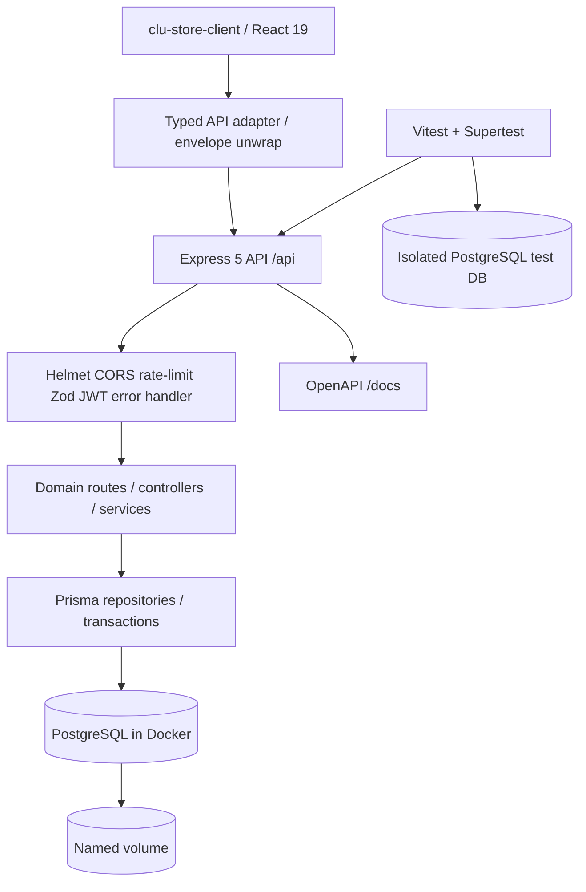
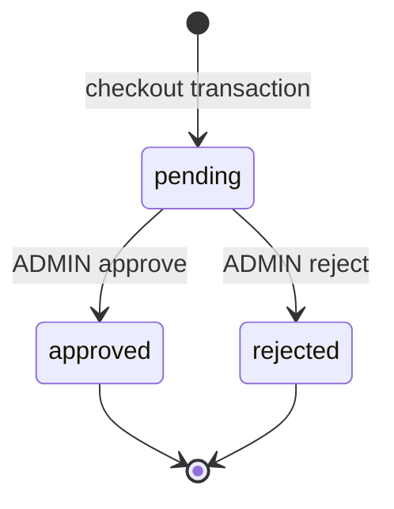

# CLU Store API — Architecture Decisions and API Contract (V1)

**Status:** Proposed contract for implementation; not yet implemented.  
**Target:** `clu-store-api` as a separately deployable REST API for `clu-store-client`.  
**Constraint:** PostgreSQL running in local Docker for development; maintain a self-hosting path. No MongoDB or hosted provider required.

## 1. Product boundary and explicit non-goals

V1 implements a complete **demo commerce backend**: product discovery, category landing content, offers, registration/login, per-user cart, transactional order placement, order history, and role-gated order approval/rejection. It does **not** imply a payment gateway, shipping provider, taxation engine, inventory reservations, stock counts, refunds, email verification, password reset, merchant back office CRUD, or a production-ready storefront. Never return a fake `paymentUri` as if payment were processed. Keep taxes and shipping out of the V1 order total unless explicit new requirements are approved.

**Default region/currency:** Chinese-language demonstration catalog in **CNY / RMB**. A `currency: "CNY"` property is required on monetary transaction DTOs and orders. No silent conversion to USD.

## 2. Technology decision record

| Decision | Recommended choice | Rationale / guardrail |
|---|---|---|
| Runtime | **Node.js 24 LTS**, pinned major for local/CI/Docker | Node 26 is Current as of 2026-10-19; use LTS for self-hosted reliability. Check patches before implementation. |
| HTTP | Express 5 + TypeScript `strict` + ESM | Natural fit for portfolio, modular routes; Express 5 forwards rejected async handler promises. |
| Database | PostgreSQL 18 in Docker, pinned major/image digest when practical | Reliable relational FKs, transactions, JSONB, indexes; avoid binding an already-used local port. |
| ORM | **Prisma 7 stable**, pin exact compatible major/minor; reassess Prisma 8 when stable | Official docs on 2026-10-19 describe Prisma 8 as RC; Prisma 7 is supported and uses `prisma.config.ts` + PostgreSQL driver adapter (`@prisma/adapter-pg`). Do not paste Prisma 6 initialization recipes. |
| Money | **Prisma Decimal / PostgreSQL `numeric(12,2)`**; JSON responses emit monetary values as decimal **strings** | No JS floating-point business arithmetic. E.g., `"7999.00"`; frontend converts for display only. `startingPrice` is informational; calculate selected model + memory upgrade. |
| API schema | Zod for params/query/body/output; use compatible Zod-to-OpenAPI tooling + contract tests | Prevent drift across runtime input, TypeScript, and OpenAPI. Verify package compatibility with installed Zod major. |
| Security | JWT HS256 strong env secret, Argon2id, role checks, Helmet, allowlisted CORS, rate limiter, limited body, Pino redaction | Do not reuse old JWT tokens; restrict login/register and all order mutations. |
| Testing | Vitest + Supertest + dedicated PostgreSQL test database | Real integration DB for transaction/idempotency/security assertions; no mock-only order tests. |
| Deployment | Multi-stage Dockerfile, Compose `api` + `postgres`, named DB volume | Reuse installed Docker engine; initialize through migrations (not `db push` in production). |
| Documentation | OpenAPI 3.x + `/docs` + sanitized Postman | All 17 original routes plus additions, with detailed schemas/examples/error cases. |

References for version-specific guidance: https://nodejs.org/en/about/previous-releases ; https://www.prisma.io/docs/orm/v7 ; https://www.prisma.io/docs/orm/v7/core-concepts/supported-databases/postgresql ; https://expressjs.com/en/5x/guide/error-handling/ .

## 3. Logical architecture



Module layout (refine without needless abstraction):

```text
src/
  app.ts                 # configure Express without listen(); importable by Supertest
  server.ts              # bind port and graceful shutdown
  config/                # env parsing, rate limits
  lib/                   # Prisma singleton, JWT, money, logger, OpenAPI
  middleware/            # validation, auth, role gate, errors
  modules/
    auth/
    products/
    categories/
    information/
    cart/
    orders/
  types/
prisma/
  schema.prisma
  seed.ts
  migrations/
tests/
  integration/
  helpers/
docs/
  api-contract.md
  decisions.md
  fixture-provenance.md
  local-development.md
postman/
.github/workflows/
Dockerfile
compose.yaml
.env.example
prisma.config.ts
```

Keep `route -> controller -> service -> repository` separation only where it buys testability; a simple domain can combine controller with a small repository if concise. No database requests in controllers.

## 4. ID and catalog rules

- Keep observed **product/category/model/memory IDs as integer IDs** for read compatibility. Preserve observed IDs from attached examples where unambiguous; seed curated additional IDs with deterministic no-collision mapping. `ProductColor` can use its own internal integer/UUID key; product DTO exposes colors as an array of names for compatibility.
- `User.id` is UUID. `CartItem.id` and `Order.id` can be integer primary keys in V1 to preserve the existing frontend/postman numeric lookup convention; avoid silently changing to UUID. Both IDs are opaque to clients and always enforce owner/role authorization.
- `Category.title` and `slug` unique. `GET /api/categories/:title` resolves a **title or slug**; URL-encoded Chinese paths are valid, e.g. `%E7%94%B5%E8%84%91`. `GET /api/categories` returns navigation summaries.
- Separate **product configuration** (model, memory, color) from presentation content (editorial features, offers, new-arrival cards). Product `image` is the public read DTO key; database may call it `imageSrc` internally, but a single serializer controls mapping.
- `startingPrice` means the **lowest sellable complete model+memory combination**, displayed only; **do not add it to `model.price`**. A model's `price` is its *full base selling price*. A memory option's `price` is the *incremental upgrade price*, persisted internally as `extraPrice`.
- For the selected SKU: `unitPrice = ProductModel.price + ProductMemorySize.extraPrice`, using Decimal only. Quantity must be a bounded positive integer. Both selected option records must belong to the same product and be in stock; color must be valid and available for that product.
- `soldOut` on marketing cards is a **display state**, not authoritative SKU stock status. Avoid deriving `Product.inStock` from a banner field.
- Seed `supports` from reviewed/sanitized content; avoid blindly publishing legacy copyright-heavy promotional language or obsolete terms. Prefer an original, demo-specific support page.

## 5. Data model and constraints

| Entity | Essential columns | Core relationships / invariants |
|---|---|---|
| `User` | `id UUID`, `username`, `email`, `passwordHash`, `role`, timestamps | normalized case-insensitive uniqueness (via `citext` or functional indexes); `role = USER / ADMIN`. No password hash in outward DTO. |
| `Category` | `id Int`, `title`, `slug`, `subTitle?`, `videos Json?`, `editorialFeatures Json?` | unique slug/title; relational products; category editorial data distinct from product features. |
| `Product` | `id Int`, `categoryId`, `name`, `title`, `imageSrc`, `carouselImages Json`, `startingPrice Decimal`, `installments Decimal?`, `features Json`, `inStock`, timestamps | category FK; `startingPrice` checked/recomputed from active SKU options. |
| `ProductModel` | `id Int`, `productId`, `name`, `specification`, `price Decimal`, `inStock` | product FK, stable ids; composite product + option validation. |
| `ProductMemorySize` | `id Int`, `productId`, `name`, `extraPrice Decimal`, `inStock` | product FK and option ownership. |
| `ProductColor` | `id`, `productId`, `name`, `inStock` | `unique(productId,name)`; validate color in cart/checkout. |
| `Offer` | `id`, nullable `productId`, `type`, `title`, `detail`, `imageSrc`, dates, `active`, `soldOut?` | preserve presentation cards even when not linked to a SKU; historical 2025 offers inactive. |
| `NewArrival` | `id`, **nullable** `productId`, `displayOrder`, `title`, `detail`, `imageSrc`, `textColor`, `soldOut` | nullable link intentionally supports editorial cards in attachment. Deterministic order. |
| `SupportInformation` | `key`, `locale`, reviewed `html`, `updatedAt` | unique `(key,locale)`; sanitize HTML and restrict editor. |
| `Cart` | `id`, `userId`, `status`, timestamps | `userId` unique: one reusable ACTIVE cart per user in V1. Checkout clears items in a transaction, retains cart. |
| `CartItem` | `id`, `cartId`, `productId`, `modelId`, `memorySizeId`, `color`, `quantity`, `unitPrice Decimal`, timestamps | composite unique configuration `(cartId,productId,modelId,memorySizeId,color)`; qty increments for same config, not just product. Cached `unitPrice` is **not** checkout authority. |
| `Order` | `id`, `userId`, `status`, `totalAmount Decimal`, `currency`, `idempotencyKey?`, `requestFingerprint?`, `metadata Json?`, timestamps | nullable key unique per `(userId,idempotencyKey)`; transaction and immutable purchase total. |
| `OrderItem` | `id`, `orderId`, `productId?`, product-name/config snapshots, `unitPrice Decimal`, `quantity`, `lineTotal Decimal` | preserve historical data even after product changes; on-delete RESTRICT for historical product references. |
| `OrderStatusHistory` | `id`, `orderId`, `fromStatus?`, `toStatus`, `operatorId`, `metadata Json?`, `createdAt` | include initial `null -> pending` and later admin transitions. |

Schema refinements: indexes on product `categoryId/name`, model/memory product FKs, orders `(userId, createdAt)`, order status, and status history `(orderId,createdAt)`; explicit cascade for ephemeral cart items and RESTRICT for historical order rows. Prisma cannot express every advanced PostgreSQL constraint by itself; add reviewed SQL migration steps for case-insensitive unique indexes or transactional invariants if needed.

### Order state machine



Each transition is atomic with an inserted history entry. `pending -> approved/rejected` exactly once via conditional update (`where status = pending`) inside a transaction; concurrent admin actions cannot both succeed. Any later transition returns 409.

## 6. Canonical JSON envelope

All non-204 API responses:

```json
{"success":true,"data":{"id":2,"name":"iPhone 16"},"meta":null}
```

Pagination:

```json
{"success":true,"data":[],"meta":{"page":1,"pageSize":20,"total":0,"totalPages":0}}
```

Errors:

```json
{"success":false,"error":{"code":"PRODUCT_NOT_FOUND","message":"Product not found","details":null}}
```

HTTP codes: `200` read/update and idempotency replay, `201` create/new checkout, `204` delete with **no JSON body**, `400` malformed syntax/path/query, `401` missing/invalid token, `403` wrong role, `404` missing/inaccessible resource, `409` duplicate/illegal transition/key conflict, `422` invalid business selection/empty cart, `429` rate limit, `500` sanitized server error, `503` readiness unavailable as appropriate.

**Compatibility statement:** original *paths* remain available, not raw body shapes. The new envelope necessarily breaks `useApiData<T>` and `useLoaderData<Product>` unless the frontend API adapter unwraps `data`. No magical transparent compatibility is claimed.

## 7. API endpoint contract (canonical plus compatibility)

| Method & route | Public / auth | Required behavior / response `data` |
|---|---|---|
| `GET /api/products/offers` | Public | Array of active, time-eligible offer-card DTOs; `type,title,detail,image,soldOut` and optional related product ID. |
| `GET /api/products/newarrivals` | Public | Display-ordered editorial/product cards, fields `title,detail,image,textColor,soldOut,productId?`. |
| `GET /api/products` | Public | Filters `keyword`, `category` (title/slug), `page`, `pageSize`, `sort`; search `name,title,category`; paginated `ProductSummary[]`; default `page=1,pageSize=20`, capped `pageSize<=100`, deterministic secondary `id`. |
| `GET /api/products/:id` | Public | Detailed `Product` with `image`, carousel, `models[].price` decimal string, `memorySizes[].price` incremental decimal string, colors as names, features. |
| `GET /api/categories/:title` | Public | `CategoryDetail`: `title`, `subTitle`, videos, editorial features, and product summaries; slug OR title accepted. |
| `GET /api/information/support` | Public | `data = {html: string, locale: "zh-CN"}`; HTML sanitized/controlled, no external legacy links or arbitrary scripting. |
| `POST /api/auth/register` | Public + strict limit | Body: username, email, password, confirmPassword; **legacy** `ConfirmPassword` supported with warning/deprecation; `201 data = SafeUser`. Require email in V1; old no-email shape is rejected with explicit 400, not silently create account. |
| `POST /api/auth/login` | Public + strict limit | Body `{identifier,password}`; legacy `{username,password}` normalized; `200 data = {accessToken, tokenType:"Bearer",expiresIn,user}`. Uniform credential errors. |
| `GET /api/ShoppingCart/fake-shopping-cart` | Public | Constant synthetic demonstration cart, never another user's data. Alias also accessible at lowercase path. |
| `GET /api/ShoppingCart` | JWT | Own cart plus items (server-computed amounts). Use explicit shared route registration for lowercase `/api/shopping-cart`, not accidental Express default case insensitivity. |
| `POST /api/ShoppingCart/items` | JWT | Body `{productId,modelId,memorySizeId,color,qty}`. Ignore legacy name/price fields; validate all selected options from DB, merge on **full SKU configuration**. `201` on new line, `200` on merge, documented. |
| `DELETE /api/ShoppingCart/items/:id` | JWT | Delete owned line by cart item ID, 204; cannot mutate others. |
| `DELETE /api/ShoppingCart/items` | JWT | Clear owned cart, 204; idempotent delete. |
| `POST /api/orders/place` | JWT | Recommended empty `{}` body, with `Idempotency-Key`; snapshot own cart; recalculate SKU prices; transact order/items/history/cart clear; 201 new / 200 replay. Legacy single-item request may be normalized only with untrusted prices ignored. |
| `GET /api/orders/:id` | JWT owner/admin | Order detail plus item snapshots and status history; distinguish missing/unauthorized safely (404 for another user's order is acceptable). |
| `POST /api/orders/:id/approve` | **ADMIN JWT** | Only `pending -> approved`; metadata optional structured value; atomic history insert. |
| `POST /api/orders/:id/reject` | **ADMIN JWT** | Only `pending -> rejected`; metadata optional structured value; atomic history insert. |
| `GET /api/categories` | Public (new) | Navigational category summaries. |
| `GET /api/orders` | JWT (new) | Paginated own orders. |
| `GET /api/admin/orders` | ADMIN JWT (new) | Paginated/searchable all orders, without leaking password data. |
| `GET /health` | Public (new) | Liveness, no DB query or secret information. |
| `GET /ready` | Public (new) | DB-dependent readiness; 200 if ready, 503 if dependency unavailable. |
| `GET /docs` | Public (new) | Swagger UI for generated OpenAPI. |

**Route registration:** mount `/api/ShoppingCart` and `/api/shopping-cart` on the same router, with `case sensitive routing` configured intentionally. Preserve exact legacy capitalization while recommending kebab-case lowercase path for new clients. Place static `/offers`, `/newarrivals`, and `/place` before dynamic `/:id` so route precedence is unambiguous. Explicitly validate unsupported sort values and type coercion.

### Sort choices (V1)

`sort = newest | price_asc | price_desc | name_asc | name_desc`, default `newest`. If relevance ranking is later required for keyword searches, add `relevance` with specified ranking semantics, not an undocumented DB-dependent order. `category` supports title/slug; `keyword` is trimmed, case-insensitive, length-capped, and safely parameterized by Prisma.

### Idempotency and concurrency semantics

1. Idempotency is **per user** and scoped to `POST /api/orders/place`, header validated 1–128 printable characters (prefer UUID in client).
2. If same user/key/normalized request is replayed, return the **same prior order** with status 200 **before** testing whether the cart has since been emptied.
3. If same key is reused with conflicting checkout mode or different direct-item payload, return `409 IDEMPOTENCY_CONFLICT`.
4. Use unique `(userId,idempotencyKey)` plus a stored request fingerprint and PostgreSQL transaction; guard concurrent requests with a lock or serializable transaction plus retry for known serialization errors.
5. The cart must be snapshotted and all current SKU prices revalidated inside the transaction. Order + items + status history + clearing **only** current user's cart all commit or all roll back. Do not make a payment call inside the database transaction.
6. Separate new cart checkout actions require **new idempotency keys**. Reuse with changed cart content cannot create another order.

## 8. Security controls and error taxonomy

- JWT issuer (`iss`), audience (`aud`), subject UUID (`sub`), issue/expiry (`iat`,`exp`), algorithm allowlist, signature verified from env-only secret. Fetch current role from DB or enforce role revocation policy; do not trust caller-supplied `role`.
- Registration: normalize username/email, unique DB indexes, Argon2id password hash, minimum password policy, no fixed admin user in public seed. Initial admin via explicit protected CLI or one-time secret environment with no literal values checked in.
- Validation: Zod for every path/query/body plus response validation in tests; max JSON size (e.g. 100 KiB), HTTP method/Content-Type handling; `400` syntax, `422` valid syntax but business-invalid selection.
- Rate limiting: strict register/login per IP (+ account identifier where privacy safe), generic global limit; document proxy trust / real client IP configuration for reverse proxies.
- Logs: redact `authorization`, `cookie`, `password`, `confirmPassword`, `ConfirmPassword`, secrets and tokens; no request body dumps; Pino request ID; production errors omit stack and database details.
- Support HTML: curated safe tags/attributes/protocols; sanitize links, use CSP appropriate for Swagger; client also sanitizes as defense-in-depth.
- Docker networking: Postgres container reachable as `postgres:5432` from API; local `npm run dev` connects through `localhost:${POSTGRES_HOST_PORT}` when published; avoid binding `0.0.0.0` on host for database unless explicitly necessary.
- Test path ownership and role separation in every endpoint; POSTMAN collection must contain **no** real tokens, secrets, old IP, password samples, or legacy Authorization header literals.

Stable codes to start: `VALIDATION_ERROR`, `MALFORMED_JSON`, `UNAUTHORIZED`, `FORBIDDEN`, `RATE_LIMITED`, `USER_ALREADY_EXISTS`, `INVALID_CREDENTIALS`, `PRODUCT_NOT_FOUND`, `CATEGORY_NOT_FOUND`, `CART_ITEM_NOT_FOUND`, `INVALID_PRODUCT_CONFIGURATION`, `OUT_OF_STOCK`, `EMPTY_CART`, `ORDER_NOT_FOUND`, `ORDER_INVALID_TRANSITION`, `IDEMPOTENCY_CONFLICT`, `SERVICE_NOT_READY`, `INTERNAL_ERROR`.

## 9. Docker, database, and environment plan

Docker already exists on the developer's machine (user-reported); no ability to inspect it during this document-only review. Choose an isolated Compose project name and a host DB port only after running `docker ps`, `docker compose ls`, and inspecting active published ports. Example setup uses host port **5433** (example only) and internal `5432`:

```text
Host development: postgresql://<user>:<password>@localhost:5433/clu_store
API container:     postgresql://<user>:<password>@postgres:5432/clu_store
Test database:     postgresql://<user>:<password>@localhost:5433/clu_store_test
```

The repository `.env.example` contains placeholders, never real passwords or JWT secret. Exact DSNs shown above are **illustrations**, not deployable credentials. In Compose, inject `POSTGRES_USER`, `POSTGRES_PASSWORD`, `POSTGRES_DB`, `JWT_SECRET`, `JWT_ISSUER`, `JWT_AUDIENCE`, `CORS_ORIGINS`, `PORT`, and `NODE_ENV` from local `.env`/runtime secret store. Use a dedicated named PostgreSQL volume and container healthchecks, `depends_on: condition: service_healthy` where appropriate, API graceful shutdown, and migrations through an explicit one-shot command / migration job. `db push` is not a substitute for checked-in migrations.

### Development commands to implement and verify later

```bash
npm ci
npm run dev
npm run lint
npm run typecheck
npm test
npm run build
npm run db:migrate:dev
npm run db:seed
docker compose up -d postgres
docker compose up --build -d
docker compose ps
```

**These commands have NOT been run.** The eventual scripts may add explicit `db:generate`, `db:migrate:deploy`, `test:integration`, and cleanup; the implementation prompts require a recorded result for each phase.

## 10. Data provisioning and testability

- Convert trusted sample JSON into curated **seed fixtures** with provenance mappings; no runtime remote calls to legacy host. Maintain `docs/fixture-provenance.md` recording source, transform, assigned IDs, duplicate fixes, and image replacements without quoting sensitive tokens/IP.
- Use `upsert` or a transaction-managed sync keyed by stable IDs; seed is **idempotent** and never arbitrarily deletes real users, carts, or orders.
- Keep demo assets local and legally reusable; simple neutral placeholders are acceptable only for media and must be explicitly identified, not used to fake implementation of business endpoints.
- Test with a dedicated temporary PostgreSQL database for auth, cross-user access, server price checks, order snapshot, transaction rollback and concurrency. No test may mutate the developer's regular `clu_store` data.
- Document how to create an admin with a secure, *explicit* CLI. Never seed a public known administrator password.

## 11. Phase exit criteria / definition of done

A phase can be marked complete only with modified-file summary, behavior summary, commands actually run, test outcomes and any blocker. V1 is done when 17 historical paths plus lowercase cart aliases and new routes behave as documented; database migrations and repeated seed succeed; SKU price is server-authoritative; auth+ADMIN gates and order state machine succeed; real Postgres integration tests pass; lint/typecheck/test/build succeed; Compose API/Postgres readiness succeeds; Swagger and sanitized Postman exist; `git grep` audit finds no real token or legacy origin; a separate frontend milestone verifies all critical UI flows.

**Do not declare 'V1 complete' after backend CI alone** if frontend integration is tracked as part of the end-to-end goal.
