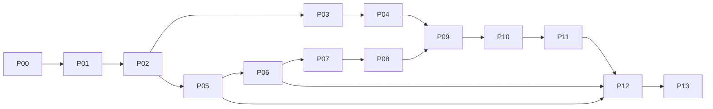

# CLU Store API — Implementation Roadmap and Codex Model Matrix

**Execution status:** All prompts are prepared; **none has been executed** in this planning turn.  
**Execution policy:** Run one prompt at a time, finish verification, inspect changes, then move to the next. Never send the entire prompt bundle to an agent as a single implementation task. No push/deploy/PR without explicit authorization.  
**Primary worktree:** `clu-store-api`; **only P12** needs `clu-store-client` changes.

## 1. Recommended sequence

| Step | Scope / milestone | Recommended model | Thinking effort | Required completion gate |
|---|---|---|---|---|
| **P00** | Establish repository docs, record local baseline, confirm contract | GPT-6.1 Sol | Medium | Remote/local diff and docs decisions audited; no unrelated edits |
| **P01** | Bootstrap TypeScript + Express 5, error envelope, config, health | GPT-6.1 Sol | Medium | App boot, Supertest health/error, lint/typecheck/build |
| **P02** | PostgreSQL Compose, Prisma 7 schema, initial migration | GPT-6 Astra | High | Isolated DB healthy; real migration success; constraints smoke-test |
| **P03** | Curated catalog seed + asset plan; repeatability | GPT-6.1 Sol | Medium | Seed rerun has same counts and stable IDs; no legacy URLs or secrets |
| **P04** | Public products/categories/offers/arrivals/support routes | GPT-6.1 Sol | High | Real DB query tests, correct response contract, pagination + search |
| **P05** | Register/login JWT + Argon2id + RBAC middleware | GPT-6 Astra | High | Real user DB auth tests, invalid/expired tokens, role gates |
| **P06** | Persistent user-owned carts and server SKU pricing | GPT-6 Astra | High | Isolation, full-configuration merge, tampered-price regression |
| **P07** | Atomic checkout + idempotency + order snapshots | GPT-6 Astra | Extra High (`xhigh`) | Transaction rollback/replay/concurrent-request tests |
| **P08** | Order list/detail + ADMIN approve/reject/history | GPT-6 Astra | High | Ownership + forbidden access + conflict/concurrency tests |
| **P09** | OpenAPI 3 / Swagger UI / sanitized Postman | GPT-6.1 Sol | Medium | All routes documented; importable collection; zero credentials |
| **P10** | Integration & negative-case test suite; CI-stable DB tests | GPT-6 Astra | High | All requested cases pass against real Postgres; no flaky tests |
| **P11** | Multi-stage API container, Compose, GitHub Actions CI | GPT-6.1 Sol | High | Build & startup & readiness; lint/typecheck/test/build CI jobs |
| **P12** | Separate frontend API integration, pricing and auth/cart flow | GPT-6.1 Sol | High | Frontend build/lint/typecheck + real API smoke workflows |
| **P13** | Security/contract final audit and V1 freeze | GPT-6 Astra | Extra High (`xhigh`) | 17 legacy + new paths checked, secret scans, regression proof |

**Model rationale.** GPT-6.1 Sol Medium is sufficient for incremental scaffolding, fixtures and OpenAPI work; High when there are cross-module dependencies. GPT-6 Astra High/Extra High is reserved for database integrity, authz, concurrency, and security review. Available labels depend on Codex/ChatGPT surface; choose the nearest selectable capable model and the listed reasoning level, not an invented model ID. Official model and reasoning references: https://developers.openai.com/api/docs/guides/code-generation ; https://developers.openai.com/api/docs/guides/reasoning .

## 2. Milestone grouping

**Milestone A — Foundation (P00–P02)**  
Establish a trustworthy baseline, source-of-truth contract, runnable Express app, PostgreSQL in existing local Docker environment, and reviewed relational schema. No business endpoints yet.

**Milestone B — Read experience (P03–P04)**  
Convert curated attached/frontend fixtures into local seed; serve search/detail/categories/marketing/support. This unblocks API testing without authentication.

**Milestone C — User transactions (P05–P08)**  
Authentication; per-user persistent cart; transaction-safe checkout; order listing and ADMIN review. Keep all money server-authoritative.

**Milestone D — Delivery quality (P09–P11)**  
OpenAPI/Postman, negative tests, Compose + CI and self-hosted operational notes.

**Milestone E — Product closure (P12–P13)**  
Integrate React frontend, fix SKU/pricing mismatch, verify realistic end-to-end behaviors and security audit.

## 3. Dependency and scope boundaries



- Backend milestone acceptance must use actual test output; absence of local Docker access should be recorded as **blocked**, not replaced by a mock DB.
- P07 must happen **after** database uniqueness constraints, cart ownership, and authenticated identity are stable. P07 is the highest correctness risk.
- P12 does not silently rewrite all frontend UX; preserve visual design and use an API adapter to unwrap envelopes, map decimal strings, and centralize `VITE_API_BASE_URL`.
- P13 is a verification/repair stage, not an excuse to rewrite functioning architecture.

## 4. Reviewer checklist after every Codex prompt

1. Read the agent's list of touched files and the `git status --short` output; ensure unrelated changes and user edits remain intact.
2. Require actual commands + exit status (not 'should pass'). No repeat runs without identified failure or fix.
3. Confirm each module's contract is preserved and tests use PostgreSQL where transactions matter.
4. Check config, generated artifacts and staged changes for real `.env`, JWT/token strings, copied legacy addresses, admin passwords, authorization headers, or old marketing references.
5. Make a **local** scoped commit only if the developer wishes. The prompt instructs Codex not to push/create PR/deploy automatically; future phases consume the local working state.

## 5. Suggested commit subjects (not executed)

```text
docs(api): establish v1 architecture and compatibility contract
chore(api): bootstrap express typescript and health endpoints
feat(db): add postgres compose and prisma relational schema
feat(seed): import curated catalog fixtures and demo content
feat(catalog): implement product and category read endpoints
feat(auth): implement secure jwt authentication and roles
feat(cart): persist user carts with trusted sku pricing
feat(orders): implement transactional checkout and idempotency
feat(orders): enforce admin transitions and audit history
docs(api): publish openapi and sanitized postman collection
test(api): cover transactional and authorization edge cases
build(api): add production docker image and github actions
feat(client): integrate live api and reconcile commerce flows
chore(api): close security audit and freeze v1 contract
```

## 6. Detailed acceptance checklist — minimum backend V1

### Runtime / database

- [ ] Clean `npm ci`, `npm run lint`, `npm run typecheck`, `npm test`, `npm run build` succeed with captured logs.
- [ ] `GET /health` liveness and `GET /ready` PostgreSQL readiness behave correctly.
- [ ] Docker Compose provisions `api` + `postgres`, healthchecks, persistent PostgreSQL volume and clean shutdown.
- [ ] Migration applies to a fresh real PostgreSQL DB; second seed run does not duplicate records.

### API functionality

- [ ] Every one of the 17 historical method/path combinations has explicit behavior and at least one test.
- [ ] New `/api/shopping-cart` and child route aliases are tested as first-class routes.
- [ ] Product query supports keyword/category/page/pageSize/sort with documented envelope.
- [ ] Catalog DTOs map `image`, `models`, `memorySizes`, `colors` and editorial category data consistently.
- [ ] Register/login, JWT validation, expired token, ADMIN-only approve/reject all work.
- [ ] No user can read/modify another user's cart/order.
- [ ] Same-SKU cart merge sums qty; differing model/memory/color do not merge.
- [ ] Client-submitted name, image and price fields cannot influence server-quoted amounts.
- [ ] Checkout uses PostgreSQL transaction; order name/options/price snapshots persist.
- [ ] Same `Idempotency-Key` returns the same order; conflict and concurrent request cases covered.
- [ ] Only pending->approved/rejected transitions possible; status-history records operator.

### Security / docs

- [ ] OpenAPI `/docs` and sanitized Postman collection contain every endpoint and consistent response schemas.
- [ ] No real JWT, database password, secret, original server IP, or unreviewed HTML content in tracked files.
- [ ] Runtime errors avoid leakage; CORS, Helmet, Zod validation, body caps, Pino redaction and rate limits work.
- [ ] Readme explains local host URL vs in-container network DSN, secure admin initialization and self-hosting.

### Frontend integration — separate closing gate

- [ ] Searches/debouncing/pagination use live `GET /api/products`, with usable metadata.
- [ ] Product details/SKU selection display the **same** authoritative price rule as cart/checkout.
- [ ] Auth uses server JWT (with a documented token lifecycle); no hardcoded demo credentials.
- [ ] Cart and order flows use API; no client-authoritative checkout amount or fake payment status.
- [ ] Support HTML safely renders; old server URLs removed.
- [ ] Actual frontend lint/build/typecheck/e2e smoke completed or blockers explicitly reported.

## 7. Input still needed for actual local execution (not a blocker for planning)

- Location of the developer's **local working copy** (required for accurate `git status`, installed Node and Docker network/port inspection); cannot be inferred from remote GitHub.
- Choice of self-owned/legally usable image assets for public demonstration; can initially use clearly identified neutral placeholders.
- Whether production operation beyond a private home Docker server is intended, if public exposure later requires reverse proxy TLS, authentication hardening, backups and monitoring.

**Decision already made by this plan:** no paid payment gateway, no third-party image scraping, no cloud-managed database, no automatic PR/push/deployment, no repo implementation during this planning request.
